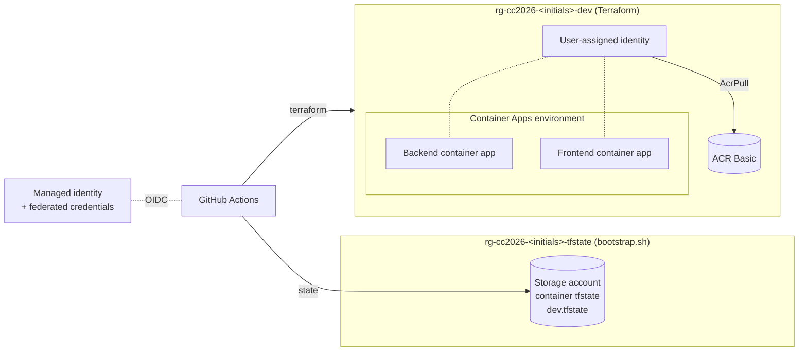

# CC2026 – Infrastructure

Terraform, bootstrap and CI/CD for the *Cloud Computing* project (UTCN, 2026–2027). It starts with Project Part 1 and is extended in later parts. This repository creates the Azure resources that run the applications from the companion repository.

> Students: name your copy `CC2026_LastName_FirstName_Infra`. This reference copy is called `CC2026_DS_Infra`.
> **Start with [docs/p1/student-walkthrough.md](docs/p1/student-walkthrough.md)**. It takes you from zero to working URLs in order.
> **Part 2 (data pipeline): start with [docs/p2/student-walkthrough.md](docs/p2/student-walkthrough.md)**. Part 1 must be deployed first.

## 1. Infrastructure architecture



More diagrams (conceptual, UML deployment, CI/CD): [docs/architecture.md](docs/architecture.md).

## 2. Azure resources

| Resource | Name (initials `agi`) | Created by | Purpose |
|---|---|---|---|
| Resource group | `rg-cc2026-agi-tfstate` | bootstrap | Holds Terraform state; outlives `terraform destroy` |
| Storage account + container `tfstate` | `sttfcc2026agi<6 hex>` | bootstrap | Remote state `dev.tfstate` |
| User-assigned managed identity (in the state RG) | `github-actions-cc2026-agi` | bootstrap | Identity used by GitHub Actions |
| Federated credentials | `github-apps-main(-ids)`, `github-infra-main(-ids)` | bootstrap | Trust GitHub OIDC tokens from `main` of each repo (name-based and ID-based subject) |
| Resource group | `rg-cc2026-agi-dev` | Terraform | Everything below |
| Container registry (Basic) | `acrcc2026agidev<4 hex>` | Terraform | Stores `backend` and `frontend` images |
| User-assigned identity | `id-cc2026-agi-dev-apps` | Terraform | The container apps pull from ACR with it (AcrPull); also reads the gold files in P2 (Storage Blob Data Reader) |
| Container Apps environment (Consumption) | `cae-cc2026-agi-dev` | Terraform | Shared environment for both apps; no VM quota needed |
| Container app | `cc2026-api-agi-dev-<4 hex>` | Terraform | Backend, port 8000 |
| Container app | `cc2026-ui-agi-dev-<4 hex>` | Terraform | Frontend, port 8080 |
| Storage account (ADLS Gen2) + containers `bronze`, `silver`, `gold` | `stcc2026agidev<4 hex>` | Terraform | P2 data lake: bronze (raw), silver (clean + `rejected/`), gold (JSON). LRS, TLS 1.2, no shared keys, no public access, soft delete 7 days |
| Data Factory (system-assigned identity, live mode) | `adf-cc2026-agi-dev-<4 hex>` | Terraform | P2 pipeline `pl-energy-etl`: data flow, copy to `gold/by-timestamp/<run>/` and `gold/latest/`, blob event trigger |
| Logic App (Consumption) | `logic-cc2026-agi-dev-notify` | Terraform | P2: turns the pipeline status into a Teams card |

With `hosting = app_service` the Container Apps environment is replaced by an App Service Plan `asp-cc2026-agi-dev` (Linux, B1), the identity is named `id-cc2026-agi-dev-webapps` and the apps are Linux Web Apps with `.azurewebsites.net` URLs.

The hex suffixes come from a hash of the subscription ID and your initials. They are deterministic: every run, local or CI, produces the same names. They keep globally unique names (ACR, container apps, Storage) from colliding between students with the same initials.

## 3. Terraform module structure

```text
terraform/
├── modules/
│   ├── container-registry/   azurerm_container_registry (admin user disabled)
│   ├── container-apps/       environment, identity + AcrPull, backend + frontend container apps
│   ├── app-service/          optional hosting (hosting = app_service): plan, identity + AcrPull, backend + frontend Web Apps
│   │                         (inputs backend_app_settings / frontend_app_settings for later parts)
│   ├── storage/              P2: ADLS Gen2 account, containers bronze / silver / gold
│   ├── data-factory/         P2: factory, linked service (managed identity), datasets,
│   │                         data flow script (dataflow/), pipeline JSON (pipeline/), blob event trigger
│   └── notification/         P2: Logic App with HTTP trigger, posts the Teams Adaptive Card
└── environments/
    └── dev/                  root module: resource group + both modules
        ├── versions.tf       Terraform >= 1.14, azurerm ~> 5.9
        ├── providers.tf      azurerm provider
        ├── backend.tf        azurerm remote state (partial configuration)
        ├── variables.tf      typed, validated inputs
        ├── locals.tf         naming and tags
        ├── main.tf           resource group + module calls
        ├── outputs.tf        names and URLs
        ├── tests/            offline `terraform test` (mocked provider)
        ├── terraform.tfvars.example
        └── .terraform.lock.hcl   provider checksums (committed)
```

Design rules, from the HashiCorp Terraform style guide and the terraform-skill guidance:
- One environment (`dev`) and small modules, one per service. No wrappers, workspaces or Terragrunt.
- Every variable has a type, a description and, where useful, a validation. Every output has a description.
- Names are computed in one place (`locals.tf`). The bootstrap script reads them from Terraform instead of copying the formula.
- No provisioners, no secrets, no hard-coded IDs. The only `depends_on` (container apps → AcrPull role assignment) is explained in a comment.

## 4. Environment configuration

| Where | File / setting | Written by |
|---|---|---|
| Your laptop | `terraform/environments/dev/terraform.tfvars` | `bootstrap.sh` (git-ignored) |
| Your laptop | `terraform/environments/dev/backend.hcl` | `bootstrap.sh` (git-ignored) |
| GitHub Actions | repository variables → `TF_VAR_*` / `-backend-config` | `bootstrap.sh` |

Both come from the same answers you give `bootstrap.sh`, so local and CI runs resolve to the same resources.

## 5. Variables, locals and outputs

| Variable | Default | Description |
|---|---|---|
| `student_initials` | – (required) | 2–5 lowercase letters, e.g. `agi` |
| `subscription_id` | – (required) | Target subscription (not a secret) |
| `project_name` | `cc2026` | Name prefix |
| `environment` | `dev` | Only `dev` exists |
| `location` | `germanywestcentral` | Azure region (must be allowed by the subscription's region policy) |
| `hosting` | `app_service` | Where the apps run: `container_apps` (no VM quota; set by bootstrap for new setups) or `app_service` (App Service Plan, needs B1 quota). The default keeps existing setups unchanged. GitHub variable `HOSTING` |
| `app_service_sku` | `B1` | Plan SKU, used only with `hosting = app_service` |
| `acr_sku` | `Basic` | Registry SKU |
| `create_web_apps` | `true` | `false` only for the first apply (see §11) |
| `teams_webhook_url` | `""` | P2: Teams Workflows webhook URL (sensitive). Empty = no Teams cards. GitHub secret `TEAMS_WEBHOOK_URL` |

Locals: `name_base` (`cc2026-agi-dev`), `unique_suffix`, all resource names, and the common `tags` (`project`, `environment`, `owner`, `course`, `managed_by`).

| Output | Used by |
|---|---|
| `resource_group_name` | Apps repo variable `RESOURCE_GROUP` |
| `acr_name`, `acr_login_server` | Apps repo variable `ACR_NAME` |
| `backend_webapp_name`, `frontend_webapp_name` | Apps repo variables `BACKEND_WEBAPP_NAME`, `FRONTEND_WEBAPP_NAME` |
| `backend_url`, `frontend_url` | You (submission) – `null` until the apps exist |
| `storage_account_name`, `storage_blob_endpoint`, `data_factory_name`, `upload_command` | P2 (`az storage blob upload`, Data Factory Monitor) |

## 6. Terraform remote state

Terraform records what it created in a **state file**. Locally that file would sit on your laptop, so CI could not see it and you could lose it. Here it lives in Azure Blob Storage:

```text
storage account  sttfcc2026<initials><hash>   (resource group rg-cc2026-<initials>-tfstate)
container        tfstate
blob             dev.tfstate
```

- **Bootstrapped outside Terraform.** The storage must exist before `terraform init`, so Terraform cannot create its own backend.
- **Entra ID only.** `use_azuread_auth = true` and shared-key access is disabled on the account. Access needs the *Storage Blob Data Contributor* role, never keys or SAS tokens.
- **Locking** uses native blob leases: two concurrent runs cannot corrupt the state.
- **Recovery.** Blob versioning and 7-day soft delete are enabled.
- **Not destroyed by `terraform destroy`.** It is in a separate resource group.

`backend.tf` contains the fixed parts (`container_name`, `key`, `use_azuread_auth`). The student-specific parts are passed at init time:

```bash
terraform init -backend-config=backend.hcl                      # local
terraform init -backend-config="storage_account_name=..." ...   # CI, from TFSTATE_* variables
```

## 7. OIDC authentication (no secrets)

GitHub Actions signs in to Azure **without any stored password**:

1. The job requests an OIDC token from GitHub (`permissions: id-token: write`). The token says, for example, *"repo `owner/CC2026_..._Infra`, ref `refs/heads/main`"*.
2. `azure/login` (and Terraform via `ARM_USE_OIDC=true`) exchanges it with Entra ID for an Azure token.
3. Entra ID accepts it only if a **federated credential** on the managed identity matches issuer, audience and subject exactly.

| Federated credential | Subject |
|---|---|
| `github-apps-main` | `repo:<owner>/<Apps repo>:ref:refs/heads/main` |
| `github-apps-main-ids` | `repo:<owner>@<owner-id>/<Apps repo>@<repo-id>:ref:refs/heads/main` |
| `github-infra-main` | `repo:<owner>/<Infra repo>:ref:refs/heads/main` |
| `github-infra-main-ids` | `repo:<owner>@<owner-id>/<Infra repo>@<repo-id>:ref:refs/heads/main` |

GitHub issues one of the two subject formats depending on the repository (newer repositories include immutable IDs), so bootstrap registers both.

Pull requests, other branches and forks get no Azure access.

## 8. Azure permission prerequisites

Required for **you** (the person running `bootstrap.sh`):

| Action | Permission needed |
|---|---|
| Register resource providers, create the state RG/storage | Contributor (or Owner) on the subscription |
| Create role assignments | **Owner**, User Access Administrator or RBAC Administrator |

Granted to the **GitHub Actions identity**:

| Role | Scope | Why |
|---|---|---|
| Contributor | subscription | Terraform creates the app resource group; workflows push images and update the apps |
| Role Based Access Control Administrator, **conditioned to the roles in `ASSIGNABLE_ROLE_IDS` (today: AcrPull, Storage Blob Data Contributor, Storage Blob Data Reader)** | subscription | Terraform must grant `AcrPull` to the apps' identity and the two storage roles to Data Factory and the backend. Plain Contributor cannot create role assignments; the condition stops this identity from granting itself or anyone else any other role |
| Storage Blob Data Contributor | state storage account | Read/write/lock `dev.tfstate` |

> **Trade-off, stated plainly:** one identity serves both repositories and holds Contributor on the whole subscription. That is acceptable for a personal lab subscription, but it is broader than production practice. A production setup would use one identity per repository and pre-create the resource group, so Contributor could be scoped to it.

### Azure for Students subscriptions

| Constraint | Effect | Handled by |
|---|---|---|
| Policy *Allowed resource deployment regions* (e.g. germanywestcentral, francecentral, swedencentral, spaincentral, polandcentral) | Deployments elsewhere fail with `RequestDisallowedByPolicy` | `bootstrap.sh` reads the policy, defaults to an allowed region and rejects others |
| App Service VMs (B1) are often blocked or have quota 0 | This is why new setups use Container Apps (Consumption, no VM quota) | Preflight checks that the region offers Container Apps; with `HOSTING=app_service` it checks the B1 quota instead |
| Fixed credit, no pay-as-you-go | Resources stop when credit runs out | Use Container Apps (Consumption) + ACR Basic only; run `cleanup.sh` after the final evaluation |
| University tenant blocks app registrations | No Entra application possible | Bootstrap uses a user-assigned managed identity (below) |
| Owner may be constrained (cannot assign RBAC roles to others) | GitHub identity cannot create AcrPull assignments | Local stage-3 apply (§11) |

### Why a managed identity (no Microsoft Entra permissions needed)

Azure for Students subscriptions live in the university's tenant, which usually blocks app registrations for students (you may not even see Microsoft Entra ID in the portal). So GitHub Actions signs in as a **user-assigned managed identity** `github-actions-cc2026-<initials>` in `rg-cc2026-<initials>-tfstate`, never an Entra application. A managed identity is an Azure resource: creating it, its GitHub federated credentials and its role assignments needs only Owner on your subscription. Bootstrap does not call Microsoft Graph at all.

The one hard requirement is Owner (or User Access Administrator / RBAC Administrator) on *your* subscription; bootstrap stops at the preflight without it. With Azure for Students you are normally the Owner. If not, ask the instructor. If a later step fails (e.g. a federated credential), bootstrap prints the exact commands it could not run and exits with code 2.

## 9. Bootstrap execution

```bash
az login
gh auth login --scopes workflow   # 'workflow' is needed to push .github/workflows files
./bootstrap/bootstrap.sh --check   # read-only preflight: regions, Container Apps availability, role rights
./bootstrap/bootstrap.sh
```

Answers are saved to `bootstrap/bootstrap.env` (git-ignored; template `bootstrap.env.example`). The Infra repository and owner are detected from `git remote`. After renaming a repository, re-run bootstrap: it follows GitHub's redirect to the new name, updates the federated credential subject and resets the GitHub variables.

`--check` creates nothing and ends with the recommended path (all-CI, or local stage 3). The full run repeats the same checks and stops before creating anything if one fails.

The script asks for: subscription, GitHub owner, both repository names, your initials and a region. Every answer can be pre-set with an environment variable (`STUDENT_INITIALS=agi ./bootstrap/bootstrap.sh`). It is safe to re-run: existing resources are reused and never recreated.

What it does, in order: checks tools and logins → validates the repos and region → checks your permissions → registers resource providers → creates state RG, storage account (versioning, soft delete, no shared keys) and `tfstate` container → creates or reuses the managed identity → adds two federated credentials → assigns the three roles above → writes `backend.hcl` and `terraform.tfvars` → runs `terraform init` → reads resource names from Terraform → sets the GitHub variables below.

| Repository | Variables set |
|---|---|
| Apps | `AZURE_CLIENT_ID`, `AZURE_TENANT_ID`, `AZURE_SUBSCRIPTION_ID`, `ACR_NAME`, `RESOURCE_GROUP`, `BACKEND_WEBAPP_NAME`, `FRONTEND_WEBAPP_NAME` |
| Infra | `AZURE_CLIENT_ID`, `AZURE_TENANT_ID`, `AZURE_SUBSCRIPTION_ID`, `ACR_NAME`, `PROJECT_NAME`, `STUDENT_INITIALS`, `AZURE_LOCATION`, `APP_SERVICE_SKU`, `ACR_SKU`, `TFSTATE_RESOURCE_GROUP`, `TFSTATE_STORAGE_ACCOUNT`, `CI_CAN_ASSIGN_ROLES`, `CREATE_WEB_APPS` (only if not set yet) |

These are **variables, not secrets**: none of them is sensitive.

## 10. Infrastructure deployment

Normal path: *Actions → terraform → Run workflow* (branch `main`). It runs `init → validate → plan -out=tfplan → apply tfplan → output`. Untick **apply** for a plan-only run.

From your laptop (after bootstrap):

```bash
cd terraform/environments/dev
terraform init -backend-config=backend.hcl
terraform plan
terraform apply          # review the plan, then type "yes"
terraform output
```

## 11. Initial application deployment (the "first image" problem)

A container app needs an image to start, but at the beginning the registry does not exist and holds no images. Terraform must not point a container app at an image that was never published. The first deployment therefore has **two Terraform stages** inside one configuration and one state, controlled by the `create_web_apps` variable (GitHub variable `CREATE_WEB_APPS`):

| # | Where | Action | Result |
|---|---|---|---|
| 1 | Infra | `bootstrap.sh` sets `CREATE_WEB_APPS=false`; run **terraform** workflow | Resource group + ACR only |
| 2 | Apps | Push to `main` (or run **backend** and **frontend** manually) | Images `backend:<sha>`, `backend:latest`, `frontend:<sha>`, `frontend:latest` in ACR; deploy step skipped with a notice |
| 3 | Infra | `gh variable set CREATE_WEB_APPS --body true --repo <owner>/<Infra repo>`, then run **terraform** again. If bootstrap reported `CI_CAN_ASSIGN_ROLES=false`, run `terraform apply` locally instead (see below) | Environment, identity, AcrPull, container apps created on `:latest` |
| 4 | Apps | Re-run **backend** and **frontend** | Container apps switched to `:<sha>`, `/health` verified |

From then on, every push to `main` in the Apps repo deploys automatically. The Terraform workflow refuses stage 3 if `backend:latest` or `frontend:latest` is missing from ACR.

**When CI may not create role assignments.** Some tenants constrain the Owner role so it cannot delegate role-management roles (Microsoft's recommended "privileged roles" condition). Bootstrap then sets `CI_CAN_ASSIGN_ROLES=false`. Stage 3 runs once on your laptop under your own identity, which may assign AcrPull:

```bash
cd terraform/environments/dev
terraform init -backend-config=backend.hcl
terraform apply      # review: environment, identity, AcrPull, 2 container apps
```

Later CI runs only update resources and pass. The workflow stops with a clear error if a plan would create or delete role assignments.

**Never set `CREATE_WEB_APPS` back to `false`**: the next apply would delete the container apps. `bootstrap.sh` does not overwrite it once it exists.

**Image drift.** Terraform sets the image only when it creates the container app. Afterwards the Apps workflows change it to `:<sha>` (a new revision). Terraform ignores exactly one attribute, `template[0].container[0].image`. Drift in every other setting (ports, CORS, TLS, identity…) is still detected and corrected.

**Why a user-assigned identity?** With a system-assigned identity, the AcrPull role can only be granted *after* the container app exists, so the very first image pull fails. The user-assigned identity gets AcrPull first and the container apps are created afterwards. This is a deliberate deviation from "system-assigned identity".

**CORS and the frontend URL.** The frontend needs the backend URL (`API_BASE_URL`, taken from the backend's real host name). The backend needs the frontend origin (`CORS_ORIGINS`). Wiring both ways would be a dependency cycle, so both host names are built from the app names and the environment's default domain (`https://<name>.<default domain>`), which Azure assigns to the environment before the apps exist.

## 11b. Updating an existing deployment (App Service or Container Apps)

New setups run on Azure Container Apps: `bootstrap.sh` sets `HOSTING=container_apps`. App Service is still supported with `hosting = app_service`. The Terraform default is `app_service`, so an existing deployment does not change when you update. The GitHub variable names (`BACKEND_WEBAPP_NAME`, `FRONTEND_WEBAPP_NAME`, `CREATE_WEB_APPS`) did not change.

**1. Get the new version in both repositories** (everyone). Your repositories were created from a template, so add the template as a remote and copy the changed files:

```bash
# Apps repository (only the workflows; your own backend and frontend code stays untouched)
cd CC2026_<LastName>_<FirstName>_Apps
git remote add template https://github.com/agi1clj/CC2026_DS_Applications.git
git fetch template
git checkout template/p2 -- .github/workflows/backend.yml .github/workflows/frontend.yml
git commit -am "Deploy to Container Apps or App Service" && git push

# Infra repository (all files; you do not edit them)
cd ../CC2026_<LastName>_<FirstName>_Infra
git remote add template https://github.com/agi1clj/CC2026_DS_Infra.git
git fetch template
git checkout template/p2 -- .
git add -A && git commit -m "Add Container Apps hosting" && git push
```

If `git remote add` says `template` already exists, skip that line. This copies files, it does not merge, so there are no merge conflicts. Use `template/p2` while you work on Part 2: `template/main` has no Part 2 files and would remove them from your Infra repository. The Apps workflows detect on their own whether the app runs on App Service or Container Apps.

**2. You have not created the apps yet** (you never ran bootstrap, or you stopped before Step 7c of the walkthrough). Use Container Apps from the start:

```bash
HOSTING=container_apps ./bootstrap/bootstrap.sh
```

Bootstrap is safe to re-run: it updates `terraform.tfvars` and the GitHub variables (`HOSTING` included) and keeps `CREATE_WEB_APPS`. Then continue with the walkthrough at Step 7. If you never ran bootstrap, plain `./bootstrap/bootstrap.sh` already uses Container Apps.

**3. Stay on App Service.** Nothing else to do. The **terraform** workflow shows `No changes`.

**4. Move to Container Apps after the apps exist on App Service** (for example because B1 does not work for you). The URLs change.

```bash
gh variable set HOSTING --body container_apps --repo <owner>/<Infra repo>
# local apply only: add  hosting = "container_apps"  to terraform/environments/dev/terraform.tfvars
```

Then run the **terraform** workflow (*Actions → terraform → Run workflow*). If bootstrap reported `CI_CAN_ASSIGN_ROLES=false`, run it on your laptop instead:

```bash
cd terraform/environments/dev
terraform init -backend-config=backend.hcl
terraform apply
```

Terraform deletes the App Service Plan, the two Web Apps and the old identity. It creates the Container Apps environment, the new identity (`id-...-apps`), the role assignments and two container apps on `:latest`. ACR, images and state stay. Then re-run **backend** and **frontend** in the Apps repository and read the new URLs with `terraform output frontend_url backend_url` (they end in `.azurecontainerapps.io`).

You do not need to re-run `bootstrap.sh` for an existing deployment. If you do re-run it, an existing `bootstrap/bootstrap.env` keeps you on App Service; set `HOSTING=container_apps` in that file to move. For a new setup, `./bootstrap/bootstrap.sh --check` and then `./bootstrap/bootstrap.sh` work as before (§9) and use Container Apps. If the apply fails with a `Microsoft.App` registration error, run `az provider register --namespace Microsoft.App --wait`.

## 12. Terraform CI/CD

`.github/workflows/terraform.yml`:

| Event | Jobs | Azure access |
|---|---|---|
| Pull request / push to `main` (paths `terraform/**`) | `validate`: `fmt -check`, `init -backend=false`, `validate`, `terraform test` | **none** |
| Manual run on `main` | `validate` → `deploy`: OIDC login, init (remote state), validate, image check, `plan -out`, `apply tfplan`, outputs | yes |

The deploy job passes the secret `TEAMS_WEBHOOK_URL` as `TF_VAR_teams_webhook_url` (P2). Set it with `gh secret set TEAMS_WEBHOOK_URL`.

Infrastructure is never applied automatically on push, and there is no destroy workflow (cleanup is the deliberate local script below).

## 13. Validation

Commands (no Azure needed):

```bash
terraform fmt -check -recursive terraform
cd terraform/environments/dev
terraform init -backend=false
terraform validate
terraform test                 # offline tests with a mocked azurerm provider
cd ../../..
shellcheck bootstrap/bootstrap.sh scripts/cleanup.sh
actionlint .github/workflows/terraform.yml
```

Results for this reference implementation (2026-10-13, Terraform 1.16.5, azurerm 5.9.0): all of the above passed. The full flow was also run against a live subscription in germanywestcentral: bootstrap, both Terraform stages (stage 3 locally, because the Owner role was constrained), five automatic app releases with commit-tagged images, and `terraform plan` reporting *No changes* after each release.

After a real deployment:

```bash
terraform output
curl "$(terraform output -raw backend_url)/health"
curl "$(terraform output -raw backend_url)/api/data"
curl "$(terraform output -raw frontend_url)/config.js"
```

## 14. Resource cleanup

Run this only after the **final** evaluation: Parts 2, 3 and the final project extend the same infrastructure.

```bash
./scripts/cleanup.sh
```

| Step | What is deleted | Confirmation |
|---|---|---|
| 1 | Application infrastructure via `terraform plan -destroy` + apply of that plan; verifies the RG is gone | type `yes` after seeing the plan |
| 2 (optional) | Role assignments of the GitHub identity + the managed identity (and its federated credentials) | type `yes` |
| 3 (optional) | State resource group, only if the state is empty | type `yes` |

If step 1 fails, the script stops and never touches the state. GitHub variables are left as they are; remove them in the repository settings if you want.

## 15. Cost considerations

| Resource | Billing model | Note |
|---|---|---|
| Container Apps (Consumption) | per vCPU-second, GiB-second and request, above a monthly free grant | Two small apps (0.25 vCPU, 0.5 GiB, one replica each). No fixed hourly charge. Check the pricing calculator: I did not measure the real monthly cost |
| ACR Basic | fixed daily rate + storage | Small but continuous |
| Storage account (state) | per GB + transactions | Negligible (a few KB) |
| Data lake storage + Data Factory + Logic App (P2) | per GB, per run, per action | Cents per month when idle. A data flow run (General Purpose, 8 cores) costs about 0.17 USD |
| Managed identities, role assignments | free | – |

Prices in this table are approximate retail prices (germanywestcentral, October 2026); check the [Azure pricing calculator](https://azure.microsoft.com/pricing/calculator/) for your region. The main fixed cost is ACR Basic; the Azure for Students credit covers the setup until the final evaluation.

**Credit running low?** Ask your instructor first. You can then pause the container apps: `gh variable set CREATE_WEB_APPS --body false --repo <owner>/<Infra repo>` and run the **terraform** workflow (deletes the environment and container apps, keeps ACR, images and state). To resume, set it back to `true`, run **terraform**, then re-run **backend** and **frontend**. The URLs stay the same only if the environment is recreated with the same default domain; read the new ones from `terraform output`. If `CI_CAN_ASSIGN_ROLES=false`, run `terraform apply -var create_web_apps=false` (pause) and `terraform apply` (resume) locally instead.

## 16. Extending (P2/P3)

P2 (data pipeline: bronze, silver and gold in Blob Storage, Data Factory, Teams notification) is implemented. Start with [docs/p2/student-walkthrough.md](docs/p2/student-walkthrough.md). The diagram is in [docs/architecture.md](docs/architecture.md). Data Factory is owned by Terraform (live mode, no Git integration): the data flow script is `terraform/modules/data-factory/dataflow/energy_etl.dfs`. Never edit it in the portal.

**Provided vs student work.** Provided: the whole pipeline, the silver Parquet output, `silver/rejected/` (bad rows with a reason) and the three gold files. Students deploy, run and explain it. The student work of P2 is in the Apps repository (the backend reads `gold/latest/`, the frontend shows charts). Optional bonus: one more gold file.

Modules, app settings, identity outputs, the RBAC allow-list and the backend data source are extension points for P3. See [docs/extending.md](docs/extending.md).

## 17. Common errors

| Error | Cause | Fix |
|---|---|---|
| `AADSTS700213` / `No matching federated identity record` | Workflow not running on `main`, or repo renamed | Run on `main`; re-run `bootstrap.sh` |
| `AuthorizationFailed ... roleAssignments/write` | Role assignment not allowed | Owner must run bootstrap; ask the instructor for the role (§8) |
| `RequestDisallowedByPolicy` | Azure for Students region policy | Re-run bootstrap with an allowed region (`AZURE_LOCATION=...`) |
| Apply fails with `already exists` or `409 Conflict` for a container app | An earlier failed apply or a delete still in progress left an app behind | Wait a minute, or `az containerapp delete -g <rg> -n <app> --yes`, then re-run |
| `MissingSubscriptionRegistration` for `Microsoft.App` | Resource provider not registered | `az provider register --namespace Microsoft.App --wait`, then re-run |
| `terraform init`: `403 AuthorizationPermissionMismatch` | Blob role not propagated yet | Wait 2–5 minutes and retry |
| `Error acquiring the state lock` | A previous run was interrupted | Make sure nothing is running, then `terraform force-unlock <LOCK_ID>` |
| Terraform workflow: `Image backend:latest not found` | Stage 2 not done | Run the Apps workflows first |
| Name already taken (ACR/container app) | Extremely unlikely with the hash suffix | Change `project_name` |
