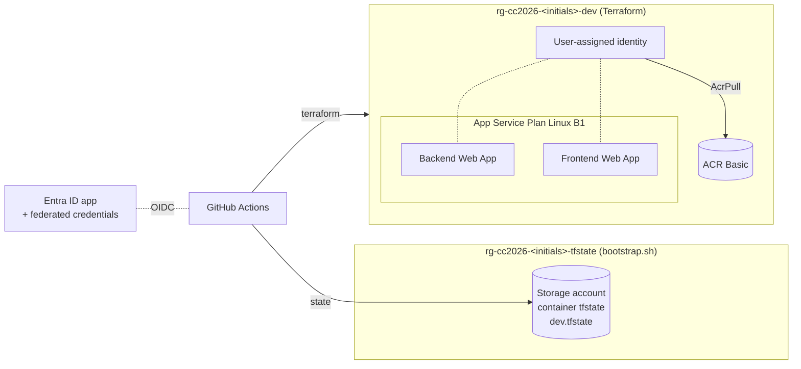

# CC2026 – Infrastructure

Terraform, bootstrap and CI/CD for the *Cloud Computing* project (UTCN, 2026–2027). It starts with Project Part 1 and is extended in later parts. This repository creates the Azure resources that run the applications from the companion repository.

> Students: name your copy `CC2026_LastName_FirstName_Infra`. This reference copy is called `CC2026_DS_Infra`.
> **Start with [docs/student-walkthrough.md](docs/student-walkthrough.md)**. It takes you from zero to working URLs in order.

## 1. Infrastructure architecture



More diagrams (conceptual, UML deployment, CI/CD): [docs/architecture.md](docs/architecture.md).

## 2. Azure resources

| Resource | Name (initials `agi`) | Created by | Purpose |
|---|---|---|---|
| Resource group | `rg-cc2026-agi-tfstate` | bootstrap | Holds Terraform state; outlives `terraform destroy` |
| Storage account + container `tfstate` | `sttfcc2026agi<6 hex>` | bootstrap | Remote state `dev.tfstate` |
| Entra application + service principal | `github-actions-cc2026-agi` | bootstrap | Identity used by GitHub Actions |
| Federated credentials | `github-apps-main`, `github-infra-main` | bootstrap | Trust GitHub OIDC tokens from `main` of each repo |
| Resource group | `rg-cc2026-agi-dev` | Terraform | Everything below |
| Container registry (Basic) | `acrcc2026agidev<4 hex>` | Terraform | Stores `backend` and `frontend` images |
| User-assigned identity | `id-cc2026-agi-dev-webapps` | Terraform | Web Apps pull from ACR with it (AcrPull); reusable for P2 data access |
| App Service Plan (Linux, B1) | `asp-cc2026-agi-dev` | Terraform | One shared VM for both apps |
| Linux Web App (container) | `cc2026-api-agi-dev-<4 hex>` | Terraform | Backend, port 8000 |
| Linux Web App (container) | `cc2026-ui-agi-dev-<4 hex>` | Terraform | Frontend, port 8080 |

The hex suffixes come from a hash of the subscription ID and your initials. They are deterministic: every run, local or CI, produces the same names. They keep globally unique names (ACR, Web Apps, Storage) from colliding between students with the same initials.

## 3. Terraform module structure

```text
terraform/
├── modules/
│   ├── container-registry/   azurerm_container_registry (admin user disabled)
│   └── app-service/          plan, identity + AcrPull, backend + frontend Web Apps
│                             (inputs backend_app_settings / frontend_app_settings for later parts)
└── environments/
    └── dev/                  root module: resource group + both modules
        ├── versions.tf       Terraform >= 1.14, azurerm ~> 5.9
        ├── providers.tf      azurerm provider
        ├── backend.tf        azurerm remote state (partial configuration)
        ├── variables.tf      typed, validated inputs
        ├── locals.tf         naming and tags
        ├── main.tf           resource group + module calls
        ├── outputs.tf        names and URLs
        ├── tests/            offline `terraform test` (mocked provider)
        ├── terraform.tfvars.example
        └── .terraform.lock.hcl   provider checksums (committed)
```

Design rules, from the HashiCorp Terraform style guide and the terraform-skill guidance:
- One environment (`dev`) and two small modules. No wrappers, workspaces or Terragrunt.
- Every variable has a type, a description and, where useful, a validation. Every output has a description.
- Names are computed in one place (`locals.tf`). The bootstrap script reads them from Terraform instead of copying the formula.
- No provisioners, no secrets, no hard-coded IDs. The only `depends_on` (Web Apps → AcrPull role assignment) is explained in a comment.

## 4. Environment configuration

| Where | File / setting | Written by |
|---|---|---|
| Your laptop | `terraform/environments/dev/terraform.tfvars` | `bootstrap.sh` (git-ignored) |
| Your laptop | `terraform/environments/dev/backend.hcl` | `bootstrap.sh` (git-ignored) |
| GitHub Actions | repository variables → `TF_VAR_*` / `-backend-config` | `bootstrap.sh` |

Both come from the same answers you give `bootstrap.sh`, so local and CI runs resolve to the same resources.

## 5. Variables, locals and outputs

| Variable | Default | Description |
|---|---|---|
| `student_initials` | – (required) | 2–5 lowercase letters, e.g. `agi` |
| `subscription_id` | – (required) | Target subscription (not a secret) |
| `project_name` | `cc2026` | Name prefix |
| `environment` | `dev` | Only `dev` exists |
| `location` | `germanywestcentral` | Azure region (must be allowed by the subscription's region policy) |
| `app_service_sku` | `B1` | Plan SKU (B1 or higher, needed for Always On) |
| `acr_sku` | `Basic` | Registry SKU |
| `create_web_apps` | `true` | `false` only for the first apply (see §11) |

Locals: `name_base` (`cc2026-agi-dev`), `unique_suffix`, all resource names, and the common `tags` (`project`, `environment`, `owner`, `course`, `managed_by`).

| Output | Used by |
|---|---|
| `resource_group_name` | Apps repo variable `RESOURCE_GROUP` |
| `acr_name`, `acr_login_server` | Apps repo variable `ACR_NAME` |
| `backend_webapp_name`, `frontend_webapp_name` | Apps repo variables `BACKEND_WEBAPP_NAME`, `FRONTEND_WEBAPP_NAME` |
| `backend_url`, `frontend_url` | You (submission) – `null` until the Web Apps exist |

## 6. Terraform remote state

Terraform records what it created in a **state file**. Locally that file would sit on your laptop, so CI could not see it and you could lose it. Here it lives in Azure Blob Storage:

```text
storage account  sttfcc2026<initials><hash>   (resource group rg-cc2026-<initials>-tfstate)
container        tfstate
blob             dev.tfstate
```

- **Bootstrapped outside Terraform.** The storage must exist before `terraform init`, so Terraform cannot create its own backend.
- **Entra ID only.** `use_azuread_auth = true` and shared-key access is disabled on the account. Access needs the *Storage Blob Data Contributor* role, never keys or SAS tokens.
- **Locking** uses native blob leases: two concurrent runs cannot corrupt the state.
- **Recovery.** Blob versioning and 7-day soft delete are enabled.
- **Not destroyed by `terraform destroy`.** It is in a separate resource group.

`backend.tf` contains the fixed parts (`container_name`, `key`, `use_azuread_auth`). The student-specific parts are passed at init time:

```bash
terraform init -backend-config=backend.hcl                      # local
terraform init -backend-config="storage_account_name=..." ...   # CI, from TFSTATE_* variables
```

## 7. OIDC authentication (no secrets)

GitHub Actions signs in to Azure **without any stored password**:

1. The job requests an OIDC token from GitHub (`permissions: id-token: write`). The token says, for example, *"repo `owner/CC2026_..._Infra`, ref `refs/heads/main`"*.
2. `azure/login` (and Terraform via `ARM_USE_OIDC=true`) exchanges it with Entra ID for an Azure token.
3. Entra ID accepts it only if a **federated credential** on the application matches issuer, audience and subject exactly.

| Federated credential | Subject |
|---|---|
| `github-apps-main` | `repo:<owner>/<Apps repo>:ref:refs/heads/main` |
| `github-infra-main` | `repo:<owner>/<Infra repo>:ref:refs/heads/main` |

Pull requests, other branches and forks get no Azure access.

## 8. Azure permission prerequisites

Required for **you** (the person running `bootstrap.sh`):

| Action | Permission needed |
|---|---|
| Register resource providers, create the state RG/storage | Contributor (or Owner) on the subscription |
| Create role assignments | **Owner**, User Access Administrator or RBAC Administrator |
| Create the Entra application | "Users can register applications" enabled in the tenant, or Application Developer role |

Granted to the **GitHub Actions identity**:

| Role | Scope | Why |
|---|---|---|
| Contributor | subscription | Terraform creates the app resource group; workflows push images and update Web Apps |
| Role Based Access Control Administrator, **conditioned to the roles in `ASSIGNABLE_ROLE_IDS` (today: AcrPull only)** | subscription | Terraform must grant `AcrPull` to the Web Apps' identity. Plain Contributor cannot create role assignments; the condition stops this identity from granting itself or anyone else any other role |
| Storage Blob Data Contributor | state storage account | Read/write/lock `dev.tfstate` |

> **Trade-off, stated plainly:** one identity serves both repositories and holds Contributor on the whole subscription. That is acceptable for a personal lab subscription, but it is broader than production practice. A production setup would use one identity per repository and pre-create the resource group, so Contributor could be scoped to it.

### Azure for Students subscriptions

| Constraint | Effect | Handled by |
|---|---|---|
| Policy *Allowed resource deployment regions* (e.g. germanywestcentral, francecentral, swedencentral, spaincentral, polandcentral) | Deployments elsewhere fail with `RequestDisallowedByPolicy` | `bootstrap.sh` reads the policy, defaults to an allowed region and rejects others |
| Fixed credit, no pay-as-you-go | Resources stop when credit runs out | Use B1 + ACR Basic only; run `cleanup.sh` after grading |
| University tenant may block app registrations | `az ad app create` fails | Instructor-assisted setup below |
| Owner may be constrained (cannot assign RBAC roles to others) | GitHub identity cannot create AcrPull assignments | Local stage-3 apply (§11) |

### Instructor-assisted setup

Many university tenants block app registrations or role assignments for students. `bootstrap.sh` detects this. It stops with a clear message, or prints the exact commands it could not run (exit code 2). An administrator then does this once per student:

```bash
# 1. Application + service principal
APP_ID=$(az ad app create --display-name github-actions-cc2026-<initials> --query appId -o tsv)
az ad sp create --id "$APP_ID"
# 2. Federated credentials (repeat for the Apps and Infra repositories)
az ad app federated-credential create --id "$APP_ID" --parameters \
  '{"name":"github-infra-main","issuer":"https://token.actions.githubusercontent.com","subject":"repo:<owner>/<Infra repo>:ref:refs/heads/main","audiences":["api://AzureADTokenExchange"]}'
# 3. Role assignments: print them by running bootstrap.sh as the student; it lists the exact commands.
```

The student then runs `AZURE_CLIENT_ID=<APP_ID> ./bootstrap/bootstrap.sh`. The script reuses the identity and still configures everything the student is allowed to do.

## 9. Bootstrap execution

```bash
az login
gh auth login
./bootstrap/bootstrap.sh --check   # read-only preflight: regions, B1 availability, app registration, role rights
./bootstrap/bootstrap.sh
```

`--check` creates nothing and ends with the recommended path (all-CI, or local stage 3). The full run repeats the same checks and stops before creating anything if one fails.

The script asks for: subscription, GitHub owner, both repository names, your initials and a region. Every answer can be pre-set with an environment variable (`STUDENT_INITIALS=agi ./bootstrap/bootstrap.sh`). It is safe to re-run: existing resources are reused and never recreated.

What it does, in order: checks tools and logins → validates the repos and region → checks your permissions → registers resource providers → creates state RG, storage account (versioning, soft delete, no shared keys) and `tfstate` container → creates or reuses the Entra app and service principal → adds two federated credentials → assigns the three roles above → writes `backend.hcl` and `terraform.tfvars` → runs `terraform init` → reads resource names from Terraform → sets the GitHub variables below.

| Repository | Variables set |
|---|---|
| Apps | `AZURE_CLIENT_ID`, `AZURE_TENANT_ID`, `AZURE_SUBSCRIPTION_ID`, `ACR_NAME`, `RESOURCE_GROUP`, `BACKEND_WEBAPP_NAME`, `FRONTEND_WEBAPP_NAME` |
| Infra | `AZURE_CLIENT_ID`, `AZURE_TENANT_ID`, `AZURE_SUBSCRIPTION_ID`, `ACR_NAME`, `PROJECT_NAME`, `STUDENT_INITIALS`, `AZURE_LOCATION`, `APP_SERVICE_SKU`, `ACR_SKU`, `TFSTATE_RESOURCE_GROUP`, `TFSTATE_STORAGE_ACCOUNT`, `CI_CAN_ASSIGN_ROLES`, `CREATE_WEB_APPS` (only if not set yet) |

These are **variables, not secrets**: none of them is sensitive.

## 10. Infrastructure deployment

Normal path: *Actions → terraform → Run workflow* (branch `main`). It runs `init → validate → plan -out=tfplan → apply tfplan → output`. Untick **apply** for a plan-only run.

From your laptop (after bootstrap):

```bash
cd terraform/environments/dev
terraform init -backend-config=backend.hcl
terraform plan
terraform apply          # review the plan, then type "yes"
terraform output
```

## 11. Initial application deployment (the "first image" problem)

A container Web App needs an image to start, but at the beginning the registry does not exist and holds no images. Terraform must not point a Web App at an image that was never published. The first deployment therefore has **two Terraform stages** inside one configuration and one state, controlled by the `create_web_apps` variable (GitHub variable `CREATE_WEB_APPS`):

| # | Where | Action | Result |
|---|---|---|---|
| 1 | Infra | `bootstrap.sh` sets `CREATE_WEB_APPS=false`; run **terraform** workflow | Resource group + ACR only |
| 2 | Apps | Push to `main` (or run **backend** and **frontend** manually) | Images `backend:<sha>`, `backend:latest`, `frontend:<sha>`, `frontend:latest` in ACR; deploy step skipped with a notice |
| 3 | Infra | `gh variable set CREATE_WEB_APPS --body true --repo <owner>/<Infra repo>`, then run **terraform** again. If bootstrap reported `CI_CAN_ASSIGN_ROLES=false`, run `terraform apply` locally instead (see below) | Plan, identity, AcrPull, Web Apps created on `:latest` |
| 4 | Apps | Re-run **backend** and **frontend** | Web Apps switched to `:<sha>`, `/health` verified |

From then on, every push to `main` in the Apps repo deploys automatically. The Terraform workflow refuses stage 3 if `backend:latest` or `frontend:latest` is missing from ACR.

**When CI may not create role assignments.** Some tenants constrain the Owner role so it cannot delegate role-management roles (Microsoft's recommended "privileged roles" condition). Bootstrap then sets `CI_CAN_ASSIGN_ROLES=false`. Stage 3 runs once on your laptop under your own identity, which may assign AcrPull:

```bash
cd terraform/environments/dev
terraform init -backend-config=backend.hcl
terraform apply      # review: plan, identity, AcrPull, 2 Web Apps
```

Later CI runs only update resources and pass. The workflow stops with a clear error if a plan would create or delete role assignments.

**Never set `CREATE_WEB_APPS` back to `false`**: the next apply would delete the Web Apps. `bootstrap.sh` does not overwrite it once it exists.

**Image drift.** Terraform sets the image only when it creates the Web App. Afterwards the Apps workflows change it to `:<sha>`. Terraform ignores exactly one attribute, `site_config[0].application_stack[0].docker_image_name`. Drift in every other setting (ports, CORS, TLS, identity…) is still detected and corrected.

**Why a user-assigned identity?** With a system-assigned identity, the AcrPull role can only be granted *after* the Web App exists, so the very first image pull fails. The user-assigned identity gets AcrPull first and the Web Apps are created afterwards. This is a deliberate deviation from "system-assigned identity".

**CORS and the frontend URL.** The frontend needs the backend URL (`API_BASE_URL`, taken from the backend's real host name). The backend needs the frontend origin (`CORS_ORIGINS`). Wiring both ways would be a dependency cycle, so the frontend origin is derived from its name (`https://<name>.azurewebsites.net`). A Terraform `check` block warns if Azure ever assigns a different host name.

## 12. Terraform CI/CD

`.github/workflows/terraform.yml`:

| Event | Jobs | Azure access |
|---|---|---|
| Pull request / push to `main` (paths `terraform/**`) | `validate`: `fmt -check`, `init -backend=false`, `validate`, `terraform test` | **none** |
| Manual run on `main` | `validate` → `deploy`: OIDC login, init (remote state), validate, image check, `plan -out`, `apply tfplan`, outputs | yes |

Infrastructure is never applied automatically on push, and there is no destroy workflow (cleanup is the deliberate local script below).

## 13. Validation

Commands (no Azure needed):

```bash
terraform fmt -check -recursive terraform
cd terraform/environments/dev
terraform init -backend=false
terraform validate
terraform test                 # 3 offline tests with a mocked azurerm provider
shellcheck bootstrap/bootstrap.sh scripts/cleanup.sh
actionlint .github/workflows/terraform.yml
```

Results for this reference implementation (2026-10-13, Terraform 1.16.5, azurerm 5.9.0): all of the above passed. **No Azure deployment has been run** from this repository: bootstrap, apply and the Apps deployment are untested against a live subscription.

After a real deployment:

```bash
terraform output
curl "$(terraform output -raw backend_url)/health"
curl "$(terraform output -raw backend_url)/api/data"
curl "$(terraform output -raw frontend_url)/config.js"
```

## 14. Resource cleanup

```bash
./scripts/cleanup.sh
```

| Step | What is deleted | Confirmation |
|---|---|---|
| 1 | Application infrastructure via `terraform plan -destroy` + apply of that plan; verifies the RG is gone | type `yes` after seeing the plan |
| 2 (optional) | Role assignments of the GitHub identity + Entra app (and its federated credentials) | type `yes` |
| 3 (optional) | State resource group, only if the state is empty | type `yes` |

If step 1 fails, the script stops and never touches the state. GitHub variables are left as they are; remove them in the repository settings if you want.

## 15. Cost considerations

| Resource | Billing model | Note |
|---|---|---|
| App Service Plan B1 (Linux) | **per hour while the plan exists**, even with zero traffic or stopped apps | The main cost. Delete it (`cleanup.sh`) when you are done |
| ACR Basic | fixed daily rate + storage | Small but continuous |
| Storage account (state) | per GB + transactions | Negligible (a few KB) |
| Entra app, identity, role assignments | free | – |

Check current prices for your region in the [Azure pricing calculator](https://azure.microsoft.com/pricing/calculator/); this document does not hard-code prices. Azure for Students credit covers this setup for the duration of the project if you clean up afterwards. Free (F1) plans are not used because they do not support Always On.

## 16. Extending (P2/P3)

Modules, app settings, identity outputs, the RBAC allow-list and the backend data source are all designed as extension points. See [docs/extending.md](docs/extending.md).

## 17. Common errors

| Error | Cause | Fix |
|---|---|---|
| `AADSTS700213` / `No matching federated identity record` | Workflow not running on `main`, or repo renamed | Run on `main`; re-run `bootstrap.sh` |
| `AuthorizationFailed ... roleAssignments/write` | Role assignment not allowed | Owner must run bootstrap, or instructor-assisted setup |
| `Insufficient privileges to complete the operation` (az ad app create) | Tenant blocks app registrations | Instructor-assisted setup |
| `RequestDisallowedByPolicy` | Azure for Students region policy | Re-run bootstrap with an allowed region (`AZURE_LOCATION=...`) |
| `This region has quota of 0 instances` | No B1 quota in that region | Choose another region |
| `terraform init`: `403 AuthorizationPermissionMismatch` | Blob role not propagated yet | Wait 2–5 minutes and retry |
| `Error acquiring the state lock` | A previous run was interrupted | Make sure nothing is running, then `terraform force-unlock <LOCK_ID>` |
| Terraform workflow: `Image backend:latest not found` | Stage 2 not done | Run the Apps workflows first |
| Name already taken (ACR/Web App) | Extremely unlikely with the hash suffix | Change `project_name` |
