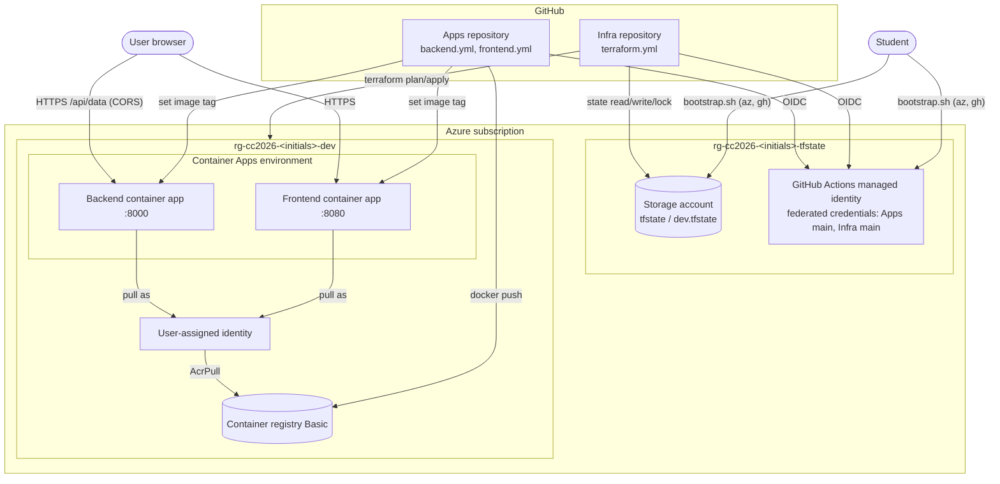
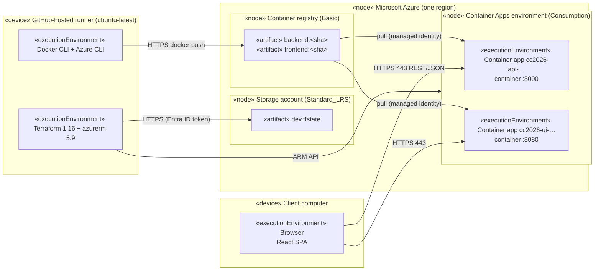
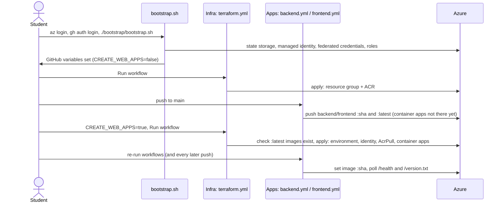
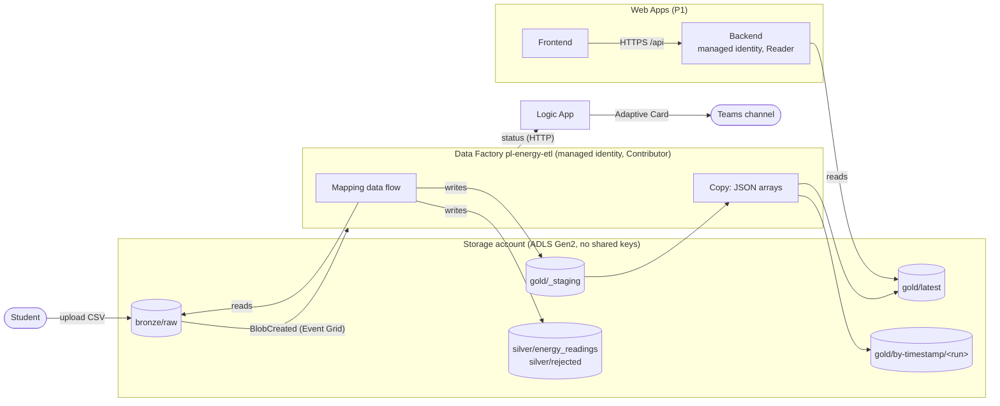

# Architecture – CC2026 Infrastructure

These diagrams show only what the code creates.

## Conceptual architecture

## UML deployment diagram

Mermaid has no native UML deployment diagram, so nodes and artifacts are drawn with UML stereotypes.

## CI/CD and first-deployment flow

## Part 2: data pipeline

Each run overwrites silver and `gold/latest/`. `gold/by-timestamp/` keeps one folder per run. The backend reads only `gold/latest/`.

## Ownership

| Concern | Owner |
|---|---|
| State storage, GitHub Actions managed identity, its role assignments, GitHub variables | `bootstrap.sh` (once) |
| Resource group, ACR, environment, identity + AcrPull, container apps, app settings, ports, TLS | Terraform |
| Which image tag runs | Apps workflows (Terraform ignores the image only) |
| P2: storage, Data Factory (data flow, pipeline, trigger), Logic App, their roles | Terraform (never edit in the portal) |
| P2: the CSV in `bronze/raw/` | The student (portal upload) |
