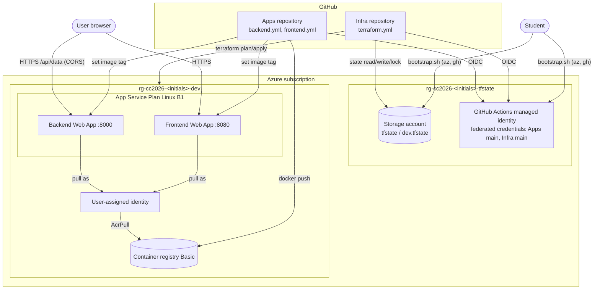
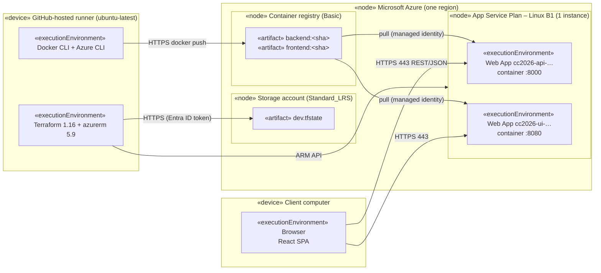
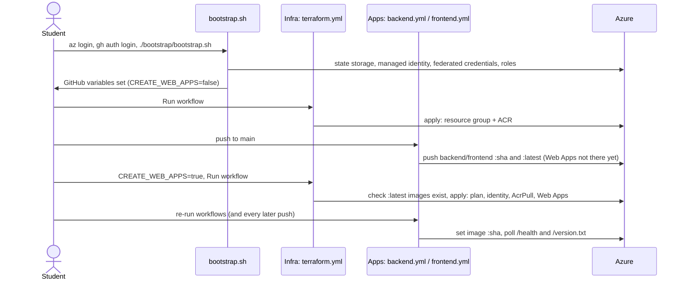

# Architecture – CC2026 Infrastructure

These diagrams show only what the code creates.

## Conceptual architecture

## UML deployment diagram

Mermaid has no native UML deployment diagram, so nodes and artifacts are drawn with UML stereotypes.

## CI/CD and first-deployment flow

## Ownership

| Concern | Owner |
|---|---|
| State storage, GitHub Actions managed identity, its role assignments, GitHub variables | `bootstrap.sh` (once) |
| Resource group, ACR, plan, identity + AcrPull, Web Apps, app settings, ports, TLS | Terraform |
| Which image tag runs | Apps workflows (Terraform ignores `docker_image_name` only) |
